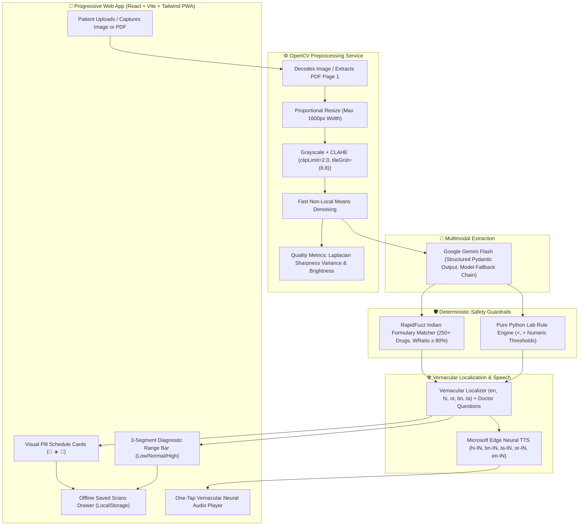

# 🩺 MedBhasha (Vernacular AI Prescription & Lab Report Decoder)

> **Fast-Track Healthcare Accessibility for Indian Patients in their Mother Tongue.**  
> Decodes handwritten doctor prescriptions, clinic discharge summaries, and pathology lab reports into verified medication schedules, plain-language diagnostic explanations, and natural neural audio in **English**, **हिंदी (Hindi)**, **ଓଡ଼ିଆ (Odia)**, **বাংলা (Bengali)**, and **தமிழ் (Tamil)**.

---

## 📌 Problem Statement & Clinical Motivation

In India and across South Asia, over **65% of patients struggle to decipher handwritten prescriptions** due to rapid physician shorthand, illegible scribbles, and complex Latin frequency notations (`1-0-1`, `TDS`, `BD`, `SOS`, `HS`). Furthermore:
- **Language Barriers**: Most medical reports and prescription pads are written in English, alienating hundreds of millions of patients who read and speak vernacular Indian languages.
- **Dosage Errors & Toxicity**: Patients frequently confuse morning, afternoon, and night dosages or consume medications on an empty stomach when food was required.
- **Diagnostic Anxiety**: Patients receiving lab reports often misunderstand complex numerical ranges, prompting panic over normal variations or ignoring critical biomarker abnormalities (such as elevated Fasting Sugar or low Hemoglobin).

**MedBhasha** solves this via a **hybrid multimodal AI pipeline** coupled with **strict deterministic verification guardrails** — ensuring patients receive empathetic, vernacular guidance without ever relying on LLM guesswork for dosages or lab abnormalities.

---

## 🏗️ System Architecture



---

## 🛡️ Key Engineering Guardrails

| Guardrail Layer | Technology | Problem Solved | Clinical Safety Guarantee |
|---|---|---|---|
| **1. Glare & Noise Defense** | OpenCV CLAHE + Non-Local Means Denoising | Eliminates hospital bulb reflection, phone sensor grain, and paper folds. | Measures Laplacian variance (`cv2.Laplacian.var()`); alerts user if image is blurry (< 100) before inference. |
| **2. Zero-Hallucination Extraction** | Gemini Flash + Pydantic Schema | Forces strict transcription of visible clinical text without inventing drugs. | Strict system prompt forbidding clinical guesswork or speculation; automatic model fallback if a model is unavailable. |
| **3. Formulary Verification** | RapidFuzz `WRatio` against 250+ Indian Drugs | Normalizes typos, spelling variants, and doctor shorthand (`Dolo-650`, `Pan-D`, `Augmentin`). | Match score $\ge 80\%$ marked `verified`; match $< 80\%$ triggers amber/red pharmacist confirmation banner. |
| **4. Deterministic Lab Rule Engine** | Pure-Python Numeric Thresholds | Determines if lab readings (`HbA1c`, `FBS`, `TSH`, etc.) are high, normal, or low. | **100% Rule Consistency: Zero LLM calculation permitted for clinical status.** |
| **5. DDI & Active Ingredient Guardrail** | Pharmacological Interaction Rules | Catches hazardous drug combinations and duplicate active salts (e.g., Paracetamol multi-brand toxicity, Blood Thinner + NSAID bleeding hazards). | High-contrast visual banners and specific clinical recommendations for pharmacist consultation. |
| **6. Dosing Safety Guardrails** | Deterministic mg/day Rules | Flags maximum daily-dose exceedance (e.g., paracetamol hepatotoxicity, NSAID burden), duplicate active salts across brands, and implausibly high per-dose counts. | Conservative, transparent thresholds; combination products and unspecified strengths are never falsely flagged. |
| **7. Offline PWA Resiliency** | Service Worker + `localStorage` | Allows patients in rural/low-connectivity areas to review past scans. | Decoded schedules and synthesized audio cached offline; browser `SpeechSynthesis` fallback. |

---

## 📊 Evaluation & Safety Benchmark Results

The automated benchmark suite (`backend/benchmark/run_benchmark.py`) tests 14 synthetic noisy prescriptions, corrupted handwriting scribbles, dangerous drug interactions, dosing guardrails, and abnormal lab readings:

```bash
python backend/benchmark/run_benchmark.py
```

### Benchmark Summary Table

| ID | Category | Input Entity | Evaluated Output | Expected Target | Verdict | Details |
|---|---|---|---|---|:---:|---|
| **TC-01** | Prescription Match | `Dolo-650 mg tab` | Dolo 650 (95.0%) | Dolo 650 (≥85.0%) | ✅ PASS | Matched generic: Paracetamol 650mg |
| **TC-02** | Prescription Match | `Augmntin 625 Duo` | Augmentin 625 Duo (97.0%) | Augmentin 625 Duo (≥85.0%) | ✅ PASS | Matched generic: Amoxicillin 500mg + Clavulanic Acid 125mg |
| **TC-03** | Prescription Match | `Pan D cap` | Pan 40 (95.0%) | Pan (≥80.0%) | ✅ PASS | Matched generic: Pantoprazole 40mg |
| **TC-04** | Prescription Match | `Glycomet 500mg` | Glycomet 500 (92.3%) | Glycomet 500 (≥85.0%) | ✅ PASS | Matched generic: Metformin 500mg |
| **TC-05** | Hallucination Defense | `XyloCure99 MegaMax` | Score 45.0% -> low_confidence | low_confidence (< 80%) | ✅ PASS | Flagged with pharmacist check warning |
| **TC-06** | Hallucination Defense | `ZzzAbcQrt Scribble` | Score 51.4% -> low_confidence | low_confidence (< 80%) | ✅ PASS | Flagged with pharmacist check warning |
| **TC-07** | Lab Numeric Rule | `FBS: 142.0 mg/dL` | Fasting Blood Sugar -> HIGH | Fasting Blood Sugar -> HIGH | ✅ PASS | Range: 70.0 - 99.0 mg/dL |
| **TC-08** | Lab Numeric Rule | `HbA1c: 7.6%` | HbA1c -> HIGH | HbA1c -> HIGH | ✅ PASS | Range: 4.0 - 5.6 % (Non-diabetic) |
| **TC-09** | Lab Numeric Rule | `Hemoglobin: 10.2 g/dL` | Hemoglobin -> LOW | Hemoglobin -> LOW | ✅ PASS | Range: 12.0 - 17.5 g/dL |
| **TC-10** | Lab Numeric Rule | `Serum TSH: 6.8 uIU/mL` | TSH -> HIGH | TSH -> HIGH | ✅ PASS | Range: 0.40 - 4.50 uIU/mL |
| **TC-11** | DDI & Duplicate Guard | `Ecosprin 75 + Combiflam` | DANGER: Critical Bleeding Risk | DANGER (drug_interaction) | ✅ PASS | Blood Thinner + NSAID interaction alert |
| **TC-12** | DDI & Duplicate Guard | `Dolo 650 + Combiflam` | WARNING: Duplicate Paracetamol | WARNING (duplicate_ingredient) | ✅ PASS | Hepatotoxicity active ingredient alert |
| **TC-13** | Dosing Guardrail | `Paracetamol 1000mg, 2-2-2` | DANGER: Max Daily Dose Exceeded | DANGER (clinical_caution) | ✅ PASS | ~6000 mg/day > 4000 mg/day safe limit |
| **TC-14** | Dosing Guardrail | `Glycomet 500 + Metformin 500` | WARNING: Duplicate Active Salt | WARNING (duplicate_ingredient) | ✅ PASS | Same salt prescribed under two brands |

### Metrics Summary
- **Overall Pass Rate**: `14/14 (100.0%)`
- **Fuzzy Prescription Matching Accuracy**: `100.0%`
- **Hallucination & Ambiguity Defense Catch Rate**: `100.0%`
- **Deterministic Lab Classification Precision**: `100.0%`
- **DDI, Dosing & Active Ingredient Safety Precision**: `100.0%`
- **Evaluation Latency**: `< 50 ms`

---

## 📁 Repository Directory Structure

```tree
medbhasha/
├── backend/
│   ├── .env.example             # Gemini API key and environment config
│   ├── Dockerfile               # Production container for Hugging Face Spaces / Render
│   ├── main.py                  # FastAPI server with CORS, /health, /api/analyze, /api/tts
│   ├── requirements.txt         # Core dependencies
│   ├── schemas.py               # Pydantic structured output models
│   ├── benchmark/
│   │   └── run_benchmark.py     # 14-test clinical evaluation suite
│   ├── data/
│   │   └── indian_medicines.csv # Seeded with 250+ Indian pharmaceutical drugs & generic salts
│   └── services/
│       ├── __init__.py
│       ├── image_processor.py   # OpenCV CLAHE, Non-Local Means Denoising, blur & glare metrics
│       ├── gemini_extractor.py  # google-genai SDK (default gemini-3.5-flash-lite) structured extraction
│       ├── verifier.py          # RapidFuzz formulary matching & pure-Python lab rule engine
│       ├── localizer.py         # Vernacular translation (en, hi, or, bn, ta), doctor questions
│       └── tts_service.py       # Microsoft Edge Neural TTS voice streaming
├── frontend/
│   ├── public/
│   │   ├── manifest.json        # PWA Web App Manifest
│   │   ├── sw.js                # Offline Service Worker cache
│   │   ├── icon-192.svg         # PWA App Icon
│   │   └── icon-512.svg
│   ├── src/
│   │   ├── App.jsx              # Accessible scanner, visual schedules, lab cards, saved drawer
│   │   ├── sampleData.js        # 1-Click interactive sample prescription & lab report demos
│   │   ├── index.css            # Tailwind styling with high-contrast accessibility rules
│   │   └── main.jsx
│   ├── index.html
│   ├── package.json
│   ├── tailwind.config.js
│   ├── vercel.json              # Vercel deployment & SPA routing configuration
│   └── vite.config.js
└── README.md
```

---

## ⚡ Quick Start & Local Setup

### 1. Backend Setup (FastAPI)

```bash
cd backend

# Create and activate virtual environment
python -m venv venv
# Windows:
venv\Scripts\activate
# Linux/macOS:
source venv/bin/activate

# Install dependencies
pip install -r requirements.txt

# Configure environment
cp .env.example .env
# Edit .env and insert your GEMINI_API_KEY (optional for demo mode):
# GEMINI_API_KEY="your-gemini-api-key"
# Optional model override (defaults to gemini-3.5-flash-lite with automatic fallback):
# GEMINI_MODEL="gemini-3.5-flash-lite"

# Start the server
python -m uvicorn backend.main:app --host 0.0.0.0 --port 8000 --reload
```

- **Interactive Swagger Docs**: [http://localhost:8000/docs](http://localhost:8000/docs)
- **Health Check**: [http://localhost:8000/health](http://localhost:8000/health)

### 2. Frontend Setup (React + Vite PWA)

```bash
cd frontend

# Install node modules
npm install

# Start Vite dev server
npm run dev
```

Open [http://localhost:5173](http://localhost:5173) in your browser.

---

## 🔒 Privacy, Data Handling & Safety

- **No server-side storage of medical records.** Uploaded images/PDFs are processed in memory for a single request and are never written to disk or a database by the backend.
- **Browser-local history only.** Saved scans live in the user's own `localStorage` and can be cleared from the app at any time.
- **API keys stay server-side.** `GEMINI_API_KEY` is read from the backend environment and is never shipped to the browser.
- **Restricted CORS.** The API accepts browser calls only from the production frontend, Vercel preview deployments, and localhost — configurable via `CORS_ORIGINS` / `CORS_ORIGIN_REGEX`.
- **No account or identity required.** The demo needs no login, phone number, or personal identifiers.
- **Safety disclaimer.** MedBhasha is a comprehension aid, not a diagnostic or prescribing system. Every extracted medicine, dose, and lab value should be confirmed with a licensed doctor or pharmacist before any clinical decision.

---

## 🚢 Deployment Guide

### Deploy Backend (Hugging Face Spaces / Render)
1. Fork or push this repository to GitHub.
2. Create a new **Docker** Space on Hugging Face or a Web Service on Render pointing to `backend/Dockerfile`.
3. Set environment variable `GEMINI_API_KEY`.
4. The service will bind to `$PORT` with health checks on `/health`.

### Deploy Frontend (Vercel)
1. Import the repository on [Vercel](https://vercel.com).
2. Set Root Directory to `frontend`.
3. Add Environment Variable:
   - `VITE_API_BASE_URL`: URL of your deployed backend (e.g. `https://your-backend.onrender.com`).
4. Click **Deploy**. Vercel will automatically detect `frontend/vercel.json` and configure SPA routing and asset caching.

---

## 🤝 Hackathon & Presentation Highlights

- ⚡ **Zero-Friction Evaluation**: Includes **Three 1-Click Sample Demo Buttons** (*"Load Sample Prescription"*, *"Load Sample Lab Report"*, and *"Load Danger Interaction Demo"*) with realistic medical documents and complete localized guidance so judges can evaluate the app immediately without uploading personal files — the third button deliberately triggers a critical bleeding-risk DDI between Ecosprin and Combiflam.
- 🛡️ **DDI & Active Ingredient Safety Guardrail**: Clinical safety engine detects hazardous interactions (e.g., blood thinners + NSAIDs) and duplicate active ingredients (e.g., accidental paracetamol overdose) with actionable guidance.
- 🔊 **Voice Accessibility**: Real-time neural audio playback for elderly or low-literacy patients who cannot read printed text across 5 Indian languages.
- 📱 **1-Click WhatsApp Care Schedule Share**: Instantly share decoded medicine dosages, morning/afternoon/night timings, and lab warnings with family caregivers via WhatsApp.
- 🖨️ **Printable Patient Care Card**: 1-click printable A4 medication chart with daily dose checkboxes for elderly patients to pin on their wall or refrigerator.
- ⏰ **Daily Dose Alarms**: Web Notifications API integration that schedules morning (8:00 AM), afternoon (1:30 PM), and night (8:30 PM) medication reminders.
- 📱 **Installable Progressive Web App**: Fully responsive, installable on mobile homescreens, with offline caching for saved reports.
